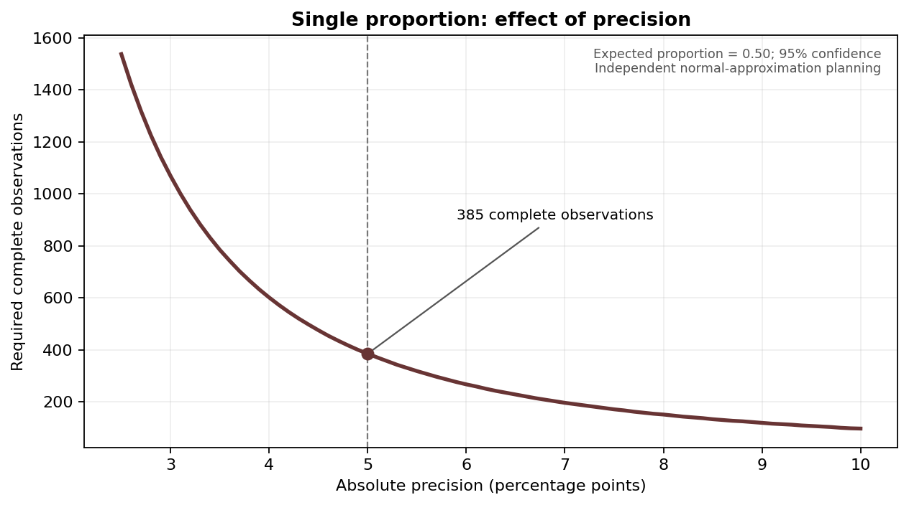

# Sample Size for a Single Proportion {#sec-single-proportion}

::: {.callout-note appearance="simple" title="Learning objectives"}
- Identify the inputs for a prevalence study.
- Calculate and report a normal-approximation planning size.
:::

## The idea

The single-proportion formula is commonly used when the primary objective is to estimate a population proportion within an absolute margin of error. Inputs are the anticipated proportion $p$, confidence level and precision $d$. The normal approximation is often introduced first because its arithmetic is transparent, but interval construction and coverage require care for small counts or proportions close to zero or one.

## When and how to apply it

If the source prevalence is uncertain, $p=0.50$ maximises $p(1-p)$ and is conservative for the standard Wald planning expression at a fixed $d$. Explicitly describe the recruitment population, selection method and any adjustments. Precision is in proportion units; 5 percentage points means $d=0.05$.

## Formula at a glance

$$
n_0=\frac{Z_{1-\alpha/2}^2p(1-p)}{d^2}
$$


## Teaching case 1 — baseline draft

::: {.callout-tip appearance="simple" title="Clinical scenario / initial worked example"}
Estimate hypertension prevalence with $p=0.50$, $d=0.05$, 95% confidence. The unrounded value is $1.96^2(0.5)(0.5)/(0.05)^2=384.16$, giving **385 complete observations** after upward rounding.
:::

::: {.panel-tabset}

### Calculation logic

The example uses the stated planning assumptions and mathematical approximation. Explain why they apply before reporting the numerical result.

### Copy-and-run R

```r
p <- .50; d <- .05; z <- qnorm(.975)
n0 <- z^2 * p * (1-p) / d^2
c(unrounded = n0, complete = ceiling(n0))
```

:::

::: {.callout-warning appearance="simple" title="Common error"}
If a survey is clustered, do not use the simple independent-observation formula as the final required sample without evaluating a design effect.
:::

## Hands-on exercise

Repeat with $p=0.30$, $d=0.04$. Show the generic formula, substituted values, complete sample and recruitment size.

::: {.callout-note collapse="true" title="Worked example 2 — insert from the teaching slides"}
**Editorial placeholder, not a validated example.** Add the second clinical example after review of the 300-slide foundation-course material. Supply the reference, parameter provenance, generic formula, numerical substitution, assumptions, complete sample size, recruitment adjustment, R script and calculator-version match. Remove this box only after statistical review.
:::

## Planning plot

The expected sample size for a single proportion increases rapidly as the requested precision becomes more demanding. @fig-precision shows an illustrative sensitivity analysis under the stated independent-sampling normal approximation.

{#fig-precision fig-align="center" width="90%"}

## Key message

The single-proportion formula estimates precision under explicitly stated sampling assumptions.
